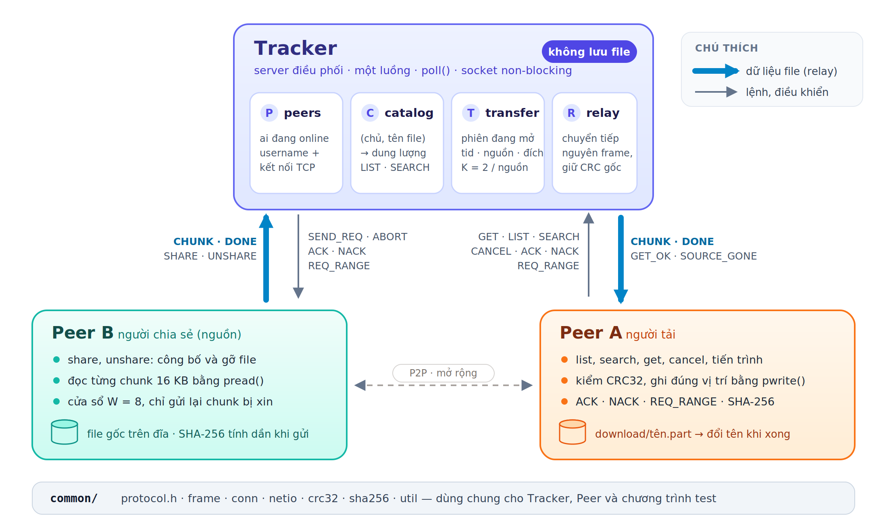
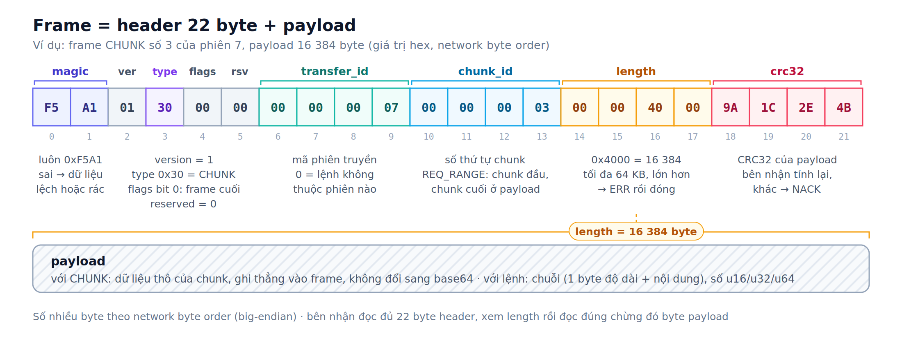
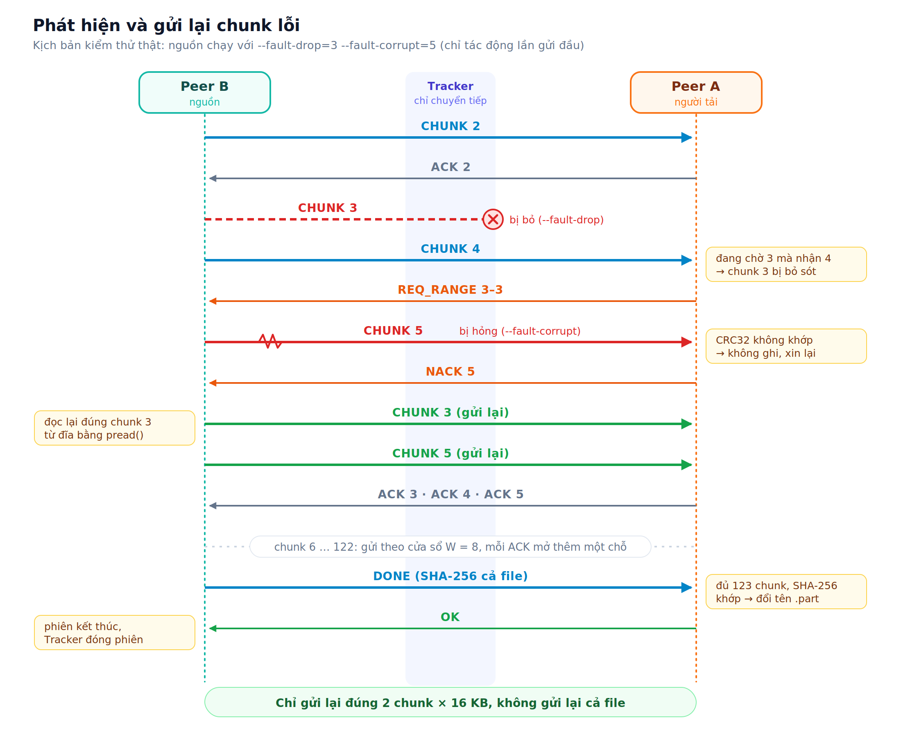
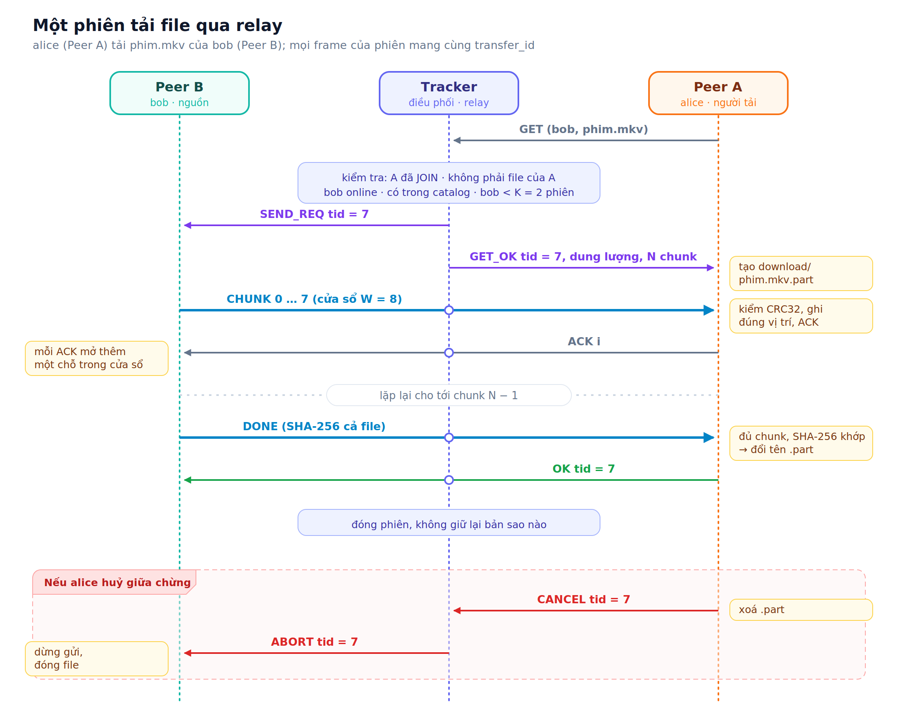

<div align="center" markdown="1">

**ĐẠI HỌC BÁCH KHOA HÀ NỘI**
Trường Công nghệ Thông tin và Truyền thông
Môn học: Lập trình mạng (IT4062)

# BÁO CÁO BÀI TẬP LỚN
## CHIA SẺ FILE QUA SERVER ĐIỀU PHỐI

Mô hình Hybrid (Relay + P2P) · Nhóm 02 thành viên · Ngôn ngữ C (POSIX sockets)

| Thành viên | MSSV | Phụ trách chính |
|---|---|---|
| Lê Ngọc Huy | 20225858 | Tracker |
| Nguyễn Minh Hiếu | 20225626 | Peer |

</div>

---

## 1. Mục tiêu và nhu cầu

Nhóm làm một hệ thống giúp nhiều người gửi file cho nhau thông qua một server trung gian, gọi là **Tracker**. Tracker không giữ file. Nó chỉ làm ba việc: biết ai đang online, biết ai đang chia sẻ file gì, và nối người cần file với người có file.

Ví dụ: An muốn lấy một file của Bình. Cả hai cùng kết nối tới Tracker. An hỏi Tracker xem đang có những file nào, chọn file của Bình, rồi Tracker chuyển file từ máy Bình sang máy An. Có thể hình dung Tracker như một bưu cục: biết người gửi, người nhận và chuyển hàng đi, nhưng không giữ lại hàng.

Hệ thống cần đáp ứng:

- **Người chia sẻ:** công bố file mình có, và gỡ đi khi không muốn chia sẻ nữa.
- **Người tải:** xem danh sách file, tìm file theo tên, tải về và thấy tải được bao nhiêu phần trăm.
- **Hệ thống:** phục vụ nhiều người cùng lúc; file lớn tải về phải đúng và đủ; một người mạng chậm hay rớt mạng không được làm cả hệ thống đứng theo.

| Yêu cầu của đề | Cách nhóm đáp ứng |
|---|---|
| Server giữ thông tin file các client chia sẻ | Tracker giữ một **catalog** (danh sách file: tên, dung lượng, chủ file), cập nhật khi có người chia sẻ, gỡ file hoặc thoát. |
| Tìm file, trả về danh sách nguồn | Lệnh LIST (xem tất cả) và SEARCH (tìm theo từ khóa). |
| Điều phối truyền file giữa hai client | Lệnh GET: file đi qua Tracker (relay). Nối thẳng P2P để ở phần mở rộng (mục 9). |
| Truyền file lớn đúng và đủ | Cắt file thành nhiều mẩu nhỏ có đánh số; mẩu nào lỗi hoặc thiếu thì chỉ gửi lại mẩu đó; cuối cùng so "dấu vân tay" của cả file. |

**Kết quả:** phần relay đã chạy đầy đủ, gồm mọi lệnh ở mục 6 và mọi tình huống lỗi ở mục 4.3. Phần P2P chưa làm.

### Một số thuật ngữ dùng trong báo cáo

| Thuật ngữ | Hiểu đơn giản |
|---|---|
| Peer | Chương trình chạy trên máy mỗi người dùng; vừa chia sẻ được, vừa tải được. |
| Nguồn / người tải | Peer đang gửi file / peer đang nhận file trong một lần tải. |
| Catalog | Danh sách file đang được chia sẻ, do Tracker giữ. |
| Frame | Một gói tin theo khuôn nhóm tự đặt: phần đầu cố định 22 byte + phần nội dung. |
| Chunk | Một mẩu file dài 16 KB. File được cắt thành nhiều chunk đánh số 0, 1, 2, ... |
| Phiên | Một lần tải một file từ nguồn sang người tải; mỗi phiên có một mã riêng (transfer_id). |
| ACK | Người tải báo: "chunk này mình nhận và ghi xuống đĩa rồi". |
| NACK | Người tải báo: "chunk này bị hỏng, gửi lại giúp". |
| REQ_RANGE | Người tải báo: "mình thiếu từ chunk a đến chunk b, gửi lại giúp". |
| CRC32 | Mã kiểm tra 4 byte đi kèm từng gói, để phát hiện gói bị hỏng dọc đường. |
| SHA-256 | "Dấu vân tay" 32 byte của cả file: hai file giống hệt nhau thì vân tay trùng nhau, khác một byte là vân tay khác hẳn. |
| Relay | Tracker đứng giữa, nhận dữ liệu từ bên này rồi chuyển sang bên kia. |
| P2P | Hai peer nối thẳng với nhau, không đi qua Tracker. |

## 2. Mô hình Hybrid

"Hybrid" nghĩa là kết hợp hai cách truyền file:

- **Relay (phần chính, đã làm):** file đi từ Peer B qua Tracker rồi tới Peer A. Tracker chỉ chuyển tiếp, truyền xong không giữ lại gì.
- **P2P (mở rộng, chưa làm):** hai peer nối thẳng với nhau, không qua Tracker, nếu mạng cho phép.

**Vì sao làm relay trước?** Relay chạy được ở mọi mạng, vì hai peer chỉ cần kết nối được tới Tracker là đủ. Còn P2P thì hay bị chặn: máy ở nhà hay ở trường thường nằm sau NAT (thiết bị giấu địa chỉ các máy bên trong, nên máy bên ngoài không gọi thẳng vào được) hoặc sau tường lửa. Vì vậy P2P để làm sau.

**Vì sao Tracker không lưu file?** Đề yêu cầu server chỉ điều phối. Không lưu file thì Tracker nhẹ, không tốn ổ đĩa và không phải lo chuyện riêng tư của file người dùng. Đo thực tế: Tracker chuyển tiếp vài chục MB mà chỉ dùng tối đa khoảng 2,4 MB RAM (mục 7).

## 3. Kiến trúc



*Hình 1. Kiến trúc và luồng hoạt động. Mũi tên xanh đậm là dữ liệu file, mũi tên xám mảnh là lệnh và điều khiển.*

Chương trình gồm ba phần:

- **Tracker** (thư mục `tracker/`) gồm bốn mảng việc:
    - nhớ ai đang online (`peers.c`);
    - nhớ catalog: file nào, của ai, dung lượng bao nhiêu (`catalog.c`);
    - nhớ các phiên tải đang diễn ra (`transfer.c`);
    - xử lý lệnh và chuyển tiếp dữ liệu giữa hai peer (`handlers.c`).
- **Peer** (thư mục `peer/`):
    - nhận lệnh người dùng gõ (`main.c`, `cli.c`);
    - quản lý các file mình chia sẻ (`shares.c`);
    - gửi file khi làm nguồn (`upload.c`);
    - nhận file khi làm người tải: ghi từng chunk xuống đĩa, kiểm tra file, hiện tiến trình, cho phép hủy (`download.c`);
    - cố ý gây lỗi để kiểm thử (`fault.c`).
- **Phần dùng chung** (thư mục `common/`): khuôn gói tin (mục 4.1), đọc/ghi gói tin, CRC32, SHA-256, kiểm tra tên file và username. Tracker, Peer và các chương trình test đều dùng chung phần này, nên hai bên luôn "nói cùng một ngôn ngữ".

Nhóm tự viết CRC32 và SHA-256 thay vì dùng thư viện OpenSSL, để chỉ cần gõ `make` là build được trên mọi máy Linux, không phải cài thêm gì. Hai hàm này được kiểm tra bằng các giá trị chuẩn đã công bố (ví dụ SHA-256 của chuỗi "abc" và của một triệu chữ "a") và so với lệnh `sha256sum` trên file thật.

## 4. Các vấn đề thiết kế chính

### 4.1. Khuôn gói tin (binary frame)

**Vấn đề.** TCP giống một đường ống nước: gửi hai thông điệp liền nhau thì bên kia nhận được một dòng byte liền mạch, không biết thông điệp này kết thúc ở đâu. Một lần đọc cũng có thể chỉ lấy được nửa thông điệp. Nếu dùng lệnh dạng chữ, kết thúc bằng dấu xuống dòng, thì lại dễ nhầm với dữ liệu file, vì file có thể chứa đủ loại byte, kể cả dấu xuống dòng.

**Cách làm.** Mỗi thông điệp được đóng thành một **frame** gồm:

- **header** (phần đầu) cố định 22 byte, giống cái phong bì ghi rõ "đây là thư loại gì, nội dung dài bao nhiêu";
- **payload** (phần nội dung) dài đúng bằng con số ghi trên header.

Bên nhận cứ đọc đủ 22 byte header, xem trường length, rồi đọc tiếp đúng chừng đó byte là được trọn một thông điệp.

| Trường | Độ dài | Ý nghĩa |
|---|---|---|
| magic | 2 byte | Luôn là 0xF5A1. Đọc ra số khác nghĩa là dữ liệu đã bị lệch hoặc là rác. |
| version | 1 byte | Phiên bản giao thức, hiện là 1. |
| type | 1 byte | Loại thông điệp: JOIN, GET, CHUNK, ... (mục 6). |
| flags | 1 byte | Cờ. Bit 0 = "đây là frame cuối" khi một câu trả lời phải chia thành nhiều frame (dùng cho danh sách file dài). |
| reserved | 1 byte | Để dành, luôn bằng 0. |
| transfer_id | 4 byte | Mã phiên tải. Bằng 0 với các lệnh không thuộc phiên nào (JOIN, LIST, ...). |
| chunk_id | 4 byte | Số thứ tự chunk. Riêng với REQ_RANGE: đây là chunk đầu, còn chunk cuối nằm trong payload. |
| length | 4 byte | Độ dài payload, tối đa 64 KB. |
| crc32 | 4 byte | Mã kiểm tra của payload. Bên nhận tính lại; nếu khác nghĩa là dữ liệu đã hỏng. |



*Hình 2. Cấu trúc frame: header 22 byte và payload, ví dụ một frame CHUNK*

Một số chi tiết đáng chú ý:

- **Thứ tự byte.** Một số như 16 384 gồm nhiều byte, và có hai cách xếp byte lớn trước hay byte nhỏ trước; các máy không phải lúc nào cũng xếp giống nhau. Nhóm quy định chung: byte lớn luôn đứng trước (network byte order), nên máy nào đọc cũng ra cùng một giá trị.
- **Chuỗi trong payload** được ghi dạng "1 byte độ dài + nội dung". Bên đọc kiểm tra chặt: thiếu byte, thừa byte hay chuỗi dài quá đều bị coi là lỗi.
- **Giới hạn 64 KB cho length.** Nếu không giới hạn, một peer lỗi chỉ cần khai length = 4 GB là Tracker có thể đi xin 4 GB RAM rồi treo. Mỗi kết nối chỉ có một bộ đệm nhận vừa đúng một frame lớn nhất. Gặp magic sai, version sai, length quá lớn, hoặc một frame gửi dở dang quá 5 giây, Tracker gửi ERR (thông báo lỗi) rồi đóng kết nối.
- **Đóng kết nối cho tử tế.** Trước khi đóng, Tracker gửi nốt thông báo lỗi ERR rồi mới đóng kết nối. Nếu đóng vội trong khi phía bên kia còn dữ liệu chưa gửi hết, hệ điều hành có thể cắt kết nối luôn, khiến ERR chưa kịp tới nơi mà peer đã bị ngắt, nên không biết mình sai gì.
- **Không dùng base64.** Dữ liệu file nằm thẳng trong payload. Đổi sang base64 (dạng chữ) sẽ làm dữ liệu phình thêm khoảng 33%.
- **Tracker chuyển tiếp nguyên frame**, giữ nguyên mã CRC32 do bên gửi tính, không tính lại. Ví dụ nếu một chunk bị hỏng ngay trong lúc nằm ở Tracker mà Tracker lại tính CRC mới theo đúng phần đã hỏng đó, thì bên nhận kiểm tra sẽ thấy CRC khớp và tưởng chunk vẫn đúng — tức là lỗi bị che mất.

### 4.2. Cắt file thành chunk, xác nhận và gửi lại

**Vấn đề.** Với file lớn có hai cách làm dễ sai:

- đọc cả file vào RAM rồi mới gửi (hoặc nhận cả file vào RAM rồi mới ghi): file vài GB là hết bộ nhớ;
- hỏng một chỗ nhỏ mà phải gửi lại cả file: rất phí.

**Cách làm.** File được cắt thành các **chunk** 16 KB, đánh số 0, 1, ..., N-1 (chunk cuối có thể nhỏ hơn). Bên gửi mỗi lần chỉ đọc đúng một chunk từ đĩa rồi gửi đi, nên dù file nặng bao nhiêu thì RAM dùng cho việc gửi cũng không quá vài trăm KB. Lần gửi đầu tiên đi lần lượt từ chunk 0 tới chunk cuối, nên bên gửi tính luôn SHA-256 trong lúc gửi, không phải đọc cả file một lượt trước khi bắt đầu.

Bên nhận xử lý mỗi chunk theo ba bước:

1. **Kiểm tra:** đúng phiên, số chunk hợp lệ, đúng độ dài (16 KB, riêng chunk cuối là phần dư), CRC32 khớp. Sai thì gửi **NACK** để xin lại chunk đó.
2. **Ghi ngay xuống đĩa:** chunk hợp lệ được ghi vào file tạm đuôi `.part`, đúng vị trí của nó (vị trí = số chunk × 16 KB), rồi gửi **ACK**. Nếu nhận lại một chunk đã có rồi (do bên gửi gửi lại) thì không ghi nữa, chỉ ACK lại.
3. **Kiểm tra cả file:** khi đã đủ chunk và nhận được **DONE**, bên nhận tính SHA-256 của file `.part` rồi so với SHA-256 mà bên gửi ghi trong DONE.
   - Khớp: đổi tên `.part` thành tên file thật, gửi OK.
   - Không khớp: xóa `.part`, gửi ERR (HASH_MISMATCH).

   Tracker chuyển kết quả này cho bên gửi rồi mới đóng phiên.

Bên gửi gửi DONE ngay khi mọi chunk đã đi ít nhất một lần, không đợi đủ ACK. Nhờ vậy, kể cả khi chunk cuối bị thất lạc, bên nhận vẫn biết là file đã hết và xin lại phần còn thiếu. Bên gửi giữ phiên mở cho tới khi nhận được OK hoặc ERR.

**Cửa sổ gửi (W = 8).** Nếu gửi một chunk rồi đứng chờ ACK mới gửi chunk tiếp thì rất chậm. Còn nếu gửi dồn hết thì dữ liệu sẽ ùn lại ở Tracker. Nhóm chọn cách ở giữa: bên gửi được phép có tối đa **8 chunk đang trên đường mà chưa có ACK**; mỗi khi có ACK thì gửi thêm. Giống như một shipper chỉ được cầm tối đa 8 kiện hàng chưa ký nhận. Nhờ vậy dữ liệu tồn ở Tracker không quá khoảng 128 KB cho mỗi phiên. Ngoài ra, bên gửi tạm ngừng khi dữ liệu chờ gửi của chính nó đã lên tới 256 KB, để không bao giờ chạm giới hạn 1 MB ở mục 4.3.

**Khi chunk bị mất hoặc hỏng.** Bên nhận giữ một bảng ghi trạng thái từng chunk: chưa có, đã có, hay đã xin gửi lại. Bên nhận phát hiện vấn đề trong ba trường hợp:

- **Chunk hỏng** (CRC32 sai, sai độ dài) hoặc ghi đĩa bị lỗi: gửi **NACK** cho chunk đó.
- **Chunk bị bỏ sót:** TCP luôn giao dữ liệu đúng thứ tự. Vì vậy nếu đang chờ chunk 3 mà lại nhận được chunk 4, thì chắc chắn chunk 3 đã bị bỏ sót. Bên nhận gửi ngay **REQ_RANGE** cho cả khoảng bị nhảy qua, không phải đợi tới cuối file.
- **Nhận DONE mà vẫn còn thiếu:** gửi REQ_RANGE cho những khoảng còn thiếu mà chưa từng xin (khoảng đã xin rồi thì không xin lặp lại).



*Hình 3. Phát hiện và gửi lại chunk lỗi (ví dụ rút gọn: bỏ sót chunk 3, làm hỏng chunk 5)*

Bên gửi chỉ đọc lại từ đĩa và gửi đúng những chunk được xin, không bao giờ gửi lại cả file. Nếu chờ quá 10 giây mà không có ACK cho một chunk, bên gửi tự gửi lại chunk đó. Mỗi chunk được gửi lại tối đa 3 lần (tính chung cả gửi lại do NACK, do REQ_RANGE và do hết giờ chờ). Quá 3 lần thì bên gửi hủy phiên và báo lỗi (ERR TIMEOUT), để không phải chờ mãi.

**Câu hỏi hay gặp: TCP đã tự đảm bảo dữ liệu đến đủ và đúng thứ tự, sao còn cần ACK, CRC32 và gửi lại?**

- **TCP chỉ bảo vệ từng đoạn đường.** Qua relay có hai kết nối TCP riêng: B tới Tracker, và Tracker tới A. Lúc dữ liệu nằm trong bộ nhớ Tracker thì TCP không bảo vệ nữa. CRC32 đi theo từng chunk từ B tới tận A, nên bắt được lỗi trên cả đường đi.
- **ACK ở đây không dùng để bù mất gói.** Gói mất thì TCP đã tự gửi lại rồi. ACK của nhóm có hai việc khác: báo rằng dữ liệu đã nằm an toàn trên đĩa, và điều chỉnh tốc độ gửi qua cửa sổ W.
- **NACK và REQ_RANGE dùng cho lỗi ở tầng ứng dụng:** chunk bị hỏng, ghi đĩa lỗi, hoặc chunk bị bỏ sót. Mục 7 cố ý gây đúng những lỗi này để kiểm tra.
- **SHA-256 là chốt chặn cuối:** bắt được mọi lỗi còn lọt qua, như ghi nhầm vị trí hay thiếu chunk.

### 4.3. Các tình huống lỗi và tình huống đặc biệt

| Tình huống | Cách xử lý |
|---|---|
| Người tải bấm hủy | Peer gửi CANCEL. Tracker báo ABORT cho nguồn để nguồn ngừng gửi, rồi đóng phiên. Người tải xóa file `.part`. Catalog không đổi, người khác vẫn tải được. |
| Nguồn gỡ file (UNSHARE) hoặc rớt mạng giữa chừng | Tracker gửi SOURCE_GONE cho mọi người đang tải file đó; họ dừng, xóa `.part` và báo lỗi. Tracker gỡ file khỏi catalog (rớt mạng thì gỡ mọi file của nguồn). |
| Nguồn xóa hoặc sửa file trên đĩa | Khi được yêu cầu gửi, nguồn kiểm tra lại dung lượng file. Không mở được hoặc dung lượng đã khác thì nguồn báo ERR; đọc file lỗi giữa chừng cũng vậy. Tracker đổi lỗi này thành SOURCE_GONE cho người tải. |
| Nhiều người cùng tải từ một nguồn | Mỗi nguồn phục vụ tối đa 2 phiên cùng lúc (K = 2). Hết chỗ thì Tracker trả BUSY để người dùng thử lại sau. Mỗi người tải chỉ tải một file một lúc. |
| Người tải rớt mạng đột ngột | Tracker báo ABORT cho nguồn, đóng phiên, xóa người đó khỏi danh sách online. |
| Người tải đọc quá chậm | Cửa sổ W đầy nên bên gửi tự chậm lại. Nếu dữ liệu chờ gửi tới một client vượt 1 MB, Tracker coi client đó bị treo và đóng kết nối (các phiên liên quan được dọn như khi rớt mạng). |
| Phiên đứng im quá lâu | Nếu 30 giây không có frame nào của phiên được chuyển tiếp, Tracker hủy phiên: ABORT cho nguồn, ERR (NO_PROGRESS) cho người tải. |
| Chunk bị hỏng hoặc thiếu | Người tải gửi NACK, hoặc REQ_RANGE nếu thiếu cả một khoảng. Nguồn chỉ gửi lại đúng các chunk đó (mục 4.2). |
| Gói tin đến sau khi phiên đã đóng | Ví dụ nguồn vẫn đang gửi vài CHUNK khi ABORT chưa tới nơi. Tracker và Peer lặng lẽ bỏ qua các frame có mã phiên không còn tồn tại, hoặc gửi sai vai (người tải lại gửi CHUNK, nguồn lại gửi ACK). |

Với phiên đứng im 30 giây, nhóm chỉ hủy phiên chứ không đóng kết nối như dự kiến ban đầu. Lý do: Tracker không biết chắc bên nào có lỗi, có thể nguồn ngừng gửi, cũng có thể người tải ngừng ACK. Còn nếu người tải thật sự không đọc dữ liệu thì đã bị bắt bởi giới hạn 1 MB ở trên.

Nếu GET và UNSHARE đến gần như cùng lúc, Tracker xử lý lần lượt theo thứ tự đến, nên kết quả luôn rõ ràng: UNSHARE đến trước thì GET báo lỗi không tìm thấy; GET đến trước thì phiên được mở rồi nhận SOURCE_GONE.

### 4.4. Phục vụ nhiều client cùng lúc

**Vấn đề.** Nếu Tracker đứng chờ để gửi cho một người mạng chậm, thì mọi client khác cũng phải đứng chờ theo.

**Cách làm.** Tracker chạy **một luồng duy nhất**, dùng `poll()` để theo dõi tất cả kết nối cùng lúc, và đặt mọi socket ở chế độ **non-blocking**: nếu chưa đọc hoặc chưa gửi được thì hàm trả về ngay để làm việc khác, không đứng chờ. Có thể hình dung như một nhân viên trực tổng đài: không ngồi chờ ở một máy, mà liên tục xem máy nào đang đổ chuông thì nghe máy đó.

Mỗi kết nối có hai bộ đệm:

- **bộ đệm nhận:** gom dần các byte cho tới khi đủ một frame;
- **hàng đợi gửi:** chứa dữ liệu chưa gửi đi được, tối đa 1 MB.

Mỗi vòng lặp của Tracker làm lần lượt:

1. Gọi `poll()` để chờ tối đa 500 ms xem kết nối nào có việc: có dữ liệu đến, hoặc đã gửi tiếp được.
2. Với mỗi kết nối có việc: đọc phần dữ liệu đang có, tách ra các frame đầy đủ và xử lý từng frame; nếu gửi được thì gửi tiếp hàng đợi.
3. Kiểm tra thời gian: frame gửi dở quá 5 giây, phiên đứng im quá 30 giây.
4. Dọn các kết nối đã bị đánh dấu cần đóng: gỡ file của họ khỏi catalog, báo cho các phiên liên quan, rồi mới giải phóng.
5. Nhận các kết nối mới.

Kết nối cần đóng chỉ được *đánh dấu* trong lúc xử lý, rồi dọn một lượt ở bước 4. Nếu xóa ngay giữa vòng lặp, các phiên tải và danh sách kết nối đang duyệt vẫn còn trỏ tới thứ đã bị xóa, và chương trình sẽ lỗi. Ngoài ra, mỗi vòng Tracker chỉ đọc tối đa 16 lần trên một kết nối, để một peer gửi liên tục không chiếm hết thời gian của các peer khác.

**Vì sao một luồng, không phải mỗi client một thread?** Với nhiều thread, khi hai thread cùng sửa catalog thì phải dùng khóa (mutex). Dùng khóa dễ dẫn tới deadlock (hai thread chờ nhau mãi nên cùng đứng) và race condition (kết quả phụ thuộc việc nào xảy ra trước). Một luồng thì không có hai vấn đề này. Nhược điểm là chỉ dùng được một nhân CPU, nhưng với quy mô bài tập lớn thì không cần nhiều hơn.

**Phía Peer** cũng dùng `poll()` để vừa nghe lệnh người dùng gõ, vừa gửi nhận chunk. Cứ 100 ms Peer kiểm tra một lần để kịp gửi lại chunk quá hạn và in tiến trình. Peer đọc bàn phím theo khối rồi tách ra từng dòng, nên vẫn chạy đúng khi người dùng dán nhiều lệnh một lúc hoặc khi lệnh được đưa vào từ script.

Tracker trả lời các lệnh thường (SHARE, LIST, GET, ...) theo đúng thứ tự nhận. Vì vậy Peer chỉ cần nhớ danh sách các lệnh đã gửi, câu trả lời đến thì ghép với lệnh đầu tiên trong danh sách. Còn các frame thuộc một phiên tải thì Peer dựa vào transfer_id để chuyển cho phần nhận file hoặc phần gửi file.

### 4.5. Kiểm tra dữ liệu đầu vào

Nguyên tắc: **không tin bất cứ dữ liệu nào nhận từ mạng**; cái gì cũng kiểm tra trước khi dùng.

- **Tên file:** dài 1 đến 255 byte, không chứa `/` hay `\`, không được là "." hay "..". Điều này chặn những tên như `../../abc` dùng để ghi đè file nằm ngoài thư mục tải về. Tracker kiểm tra khi nhận SHARE; Peer kiểm tra lại một lần nữa trước khi tải, và chỉ ghi vào thư mục tải về (mặc định `download/`, đổi được bằng tùy chọn `--dl`).
- **Thông tin phiên tải:** Peer kiểm tra chủ file và tên file đúng với cái mình đã xin, kích thước chunk đúng 16 KB, số chunk khớp với dung lượng. Sai thì hủy tải.
- **Username:** 3 đến 32 ký tự, chỉ gồm chữ, số và dấu gạch dưới. Trùng với người đang online thì báo lỗi NAME_TAKEN.
- **Dung lượng file:** lớn hơn 0 và không quá 2 GiB. Người tải tự đếm số byte nhận được: vượt dung lượng đã khai thì hủy phiên; cuối cùng thiếu hay thừa thì coi như file sai.
- **Payload:** phải đúng khuôn, đủ byte và không thừa; sai thì Tracker trả lỗi BAD_FRAME.
- **Trùng tên giữa hai người:** catalog nhận diện file bằng cặp (chủ file, tên file), nên hai người chia sẻ file cùng tên vẫn không đụng nhau.
- **Không ghi đè file có sẵn:** file được tải vào `.part` rồi mới đổi tên khi xong. Nếu tên đã có trong thư mục thì thêm số vào trước phần đuôi, ví dụ `report (1).pdf`, `report (2).pdf`.

### 4.6. Kiểm thử trong điều kiện mạng xấu

Chạy thử trên chính máy mình (localhost) thì mạng quá tốt, không chứng minh được hệ thống chịu được lỗi. Nhóm kiểm thử bằng hai cách, mỗi cách kiểm tra một điều khác nhau:

- **Giả lập mạng xấu bằng tc netem:** đây là công cụ của Linux để thêm độ trễ, làm mất gói và giới hạn tốc độ. Cách này kiểm tra rằng hệ thống vẫn chạy đúng và không bị treo khi mạng tệ. Lưu ý: vì TCP tự gửi lại gói bị mất, nên với netem chương trình chỉ thấy mạng *chậm đi*, chứ không thấy chunk nào bị mất. Script `tests/netem.sh` đặt mạng trễ 50 ms ± 10 ms, mất 5% gói, giới hạn 20 Mbit/s, rồi chạy các kịch bản tải file, tiêm lỗi, hủy tải và gỡ file giữa chừng.
- **Cố ý gây lỗi trong chương trình (fault injection):** Peer có thêm vài tùy chọn dòng lệnh dành cho kiểm thử.
    - Khi làm nguồn: `--fault-drop=3,7` cố ý *bỏ không gửi* chunk 3 và 7; `--fault-corrupt=5` cố ý *làm hỏng* chunk 5. Lỗi chỉ xảy ra ở lần gửi đầu; lần gửi lại đi bình thường.
    - Khi làm người tải: `--fault-delay=MS` làm chậm mỗi ACK một khoảng MS mili giây.

  Đây mới là cách làm cho NACK và REQ_RANGE thật sự chạy, để chứng minh chỉ chunk lỗi được gửi lại. Nguồn in ra số chunk đã gửi lại, người tải in ra số NACK và REQ_RANGE đã gửi, nên script test đối chiếu được các con số.

Các trường hợp cần thử (kết quả ở mục 7):

- Bỏ hoặc làm hỏng vài chunk: chỉ những chunk đó được gửi lại, và file tải về giống hệt file gốc.
- Mạng trễ và mất gói nhiều: file vẫn đúng; nếu chờ quá lâu thì phiên bị hủy có kiểm soát, Tracker và Peer không bị treo.
- Hủy tải, gỡ file, nguồn bận khi mạng chậm: vẫn xử lý đúng như mục 4.3.
- Người tải đọc chậm: bộ nhớ Tracker không phình lên, các client khác không bị ảnh hưởng.

## 5. Luồng hoạt động

1. Peer kết nối tới Tracker và gửi JOIN kèm username.
2. Peer B gửi SHARE (tên file, dung lượng) để công bố file. Tracker kiểm tra (mục 4.5) rồi thêm vào catalog.
3. Peer A gửi LIST để xem toàn bộ danh sách, hoặc SEARCH kèm từ khóa để tìm file (chỉ cần khớp một phần tên, không phân biệt chữ hoa chữ thường). Danh sách dài thì Tracker chia thành nhiều frame.
4. Peer A gửi GET (chủ file, tên file). Tracker kiểm tra: A đã JOIN chưa, có phải file của chính A không, chủ file còn online không, file còn trong catalog không, nguồn còn chỗ không (tối đa 2 phiên). Không đạt thì trả ERR hoặc BUSY.
5. Nếu hợp lệ, Tracker tạo một mã phiên, gửi SEND_REQ bảo Peer B bắt đầu gửi, và gửi GET_OK (kèm dung lượng, số chunk) cho Peer A. Peer B gửi từng chunk, Tracker chuyển tiếp, Peer A ghi xuống đĩa và gửi ACK (mục 4.2).
6. Gửi hết một lượt, Peer B gửi DONE kèm SHA-256. Peer A xin lại phần còn thiếu nếu có, kiểm tra SHA-256, đổi tên file rồi gửi OK. Tracker chuyển OK cho Peer B và đóng phiên, không giữ lại bản sao nào.



*Hình 4. Một phiên tải file qua relay*

Khi nhận LIST hay SEARCH, Tracker tra thẳng trong catalog của mình chứ không đi hỏi từng client. Nhờ vậy kết quả trả về ngay, không phải chờ client chậm. Catalog cũng luôn đúng, vì Tracker xóa file của một peer ngay khi peer đó mất kết nối.

## 6. Các loại thông điệp

| Loại thông điệp | Mã | Ý nghĩa |
|---|---|---|
| JOIN, QUIT, SHARE, UNSHARE, LIST, SEARCH, GET | 0x01–0x07 | Client gửi Tracker: vào hệ thống, thoát, chia sẻ file, ngừng chia sẻ, xem danh sách, tìm file, xin tải. |
| OK, ERR, LIST_RESP | 0x10–0x12 | Tracker trả lời: thành công; lỗi (kèm mã lỗi và câu mô tả); danh sách file (có thể nhiều frame, frame cuối bật bit 0 của flags). Cuối phiên, người tải cũng dùng OK/ERR để báo kết quả. |
| SEND_REQ, GET_OK, BUSY | 0x20–0x22 | Tracker mở phiên: SEND_REQ bảo nguồn bắt đầu gửi; GET_OK báo người tải dung lượng và số chunk; BUSY: nguồn đang bận. |
| CHUNK, ACK, NACK, REQ_RANGE, DONE | 0x30–0x34 | CHUNK chứa dữ liệu một chunk; ACK: đã ghi chunk xuống đĩa; NACK: xin gửi lại một chunk hỏng; REQ_RANGE: xin gửi lại một khoảng chunk; DONE: đã gửi hết, kèm SHA-256 của cả file. |
| CANCEL, ABORT, SOURCE_GONE | 0x40–0x42 | CANCEL: người tải xin hủy; ABORT: Tracker bảo nguồn dừng ngay; SOURCE_GONE: nguồn không còn file hoặc đã mất kết nối. |

Các mã lỗi trong ERR: BAD_FRAME, NOT_JOINED, ALREADY_JOINED, NAME_TAKEN, BAD_USERNAME, BAD_FILENAME, BAD_SIZE, ALREADY_SHARED, NOT_FOUND, OWNER_OFFLINE, SELF_GET, TIMEOUT, NO_PROGRESS, FILE_IO, HASH_MISMATCH, UNKNOWN_TYPE và FULL (catalog hoặc bảng phiên đã đầy; nhóm thêm mã này khi cài đặt).

Nội dung payload của từng loại, các mã lỗi và các hằng số (64 KB, W, các mốc thời gian) được ghi trong `docs/protocol.md` và `common/protocol.h`, để hai thành viên dùng chung một bản.

## 7. Kiểm thử và kết quả

Nhóm viết thêm hai chương trình giả, để mỗi người test được phần của mình mà không phải chờ người kia làm xong:

- `fake_peer`: một peer giả chạy theo kịch bản, mỗi dòng là một lệnh (`JOIN alice`, `SHARE a.txt 1000`, `BADMAGIC`, `HALF`, `EXPECT ERR NAME_TAKEN`, ...). Dùng để test Tracker, kể cả cố tình gửi frame sai khuôn hoặc gửi dở dang.
- `fake_tracker`: một Tracker giả, trả lời OK hoặc từ chối JOIN, dùng để test Peer.

Các script trong `tests/` chạy Tracker và Peer thật, rồi so SHA-256 của file gốc với file tải về. Lệnh `make test` chạy toàn bộ trong khoảng 10 giây; thêm `SLOW=1` để chạy cả những trường hợp phải chờ hết giờ thật.

| Bộ test | Nội dung | Kết quả |
|---|---|---|
| `unit_test` | Đóng gói và đọc header, payload; CRC32, SHA-256 (so với giá trị chuẩn); kiểm tra tên | 50/50 |
| `e2e_join.sh` | Vào/thoát; username sai, trùng tên; gửi lệnh trước khi JOIN; magic sai; length quá lớn; frame gửi dở 5 giây; 3 client cùng lúc | 15/15 |
| `e2e_catalog.sh` | Chia sẻ, gỡ, xem danh sách, tìm kiếm; kiểm tra đầu vào; 2000 file (danh sách nhiều frame); file biến mất khi peer thoát; SOURCE_GONE; CANCEL→ABORT; BUSY | 11/11 |
| `e2e_transfer.sh` | Tải file 1 B, 16 KB, 16 KB + 1 B, 20 MB; không ghi đè; 2 người tải cùng lúc; tiêm lỗi; BUSY; hủy tải; gỡ file giữa chừng; nguồn và người tải bị tắt đột ngột; bộ nhớ Tracker | 33/33 |
| `e2e_transfer.sh` (`SLOW=1`) | Thêm: ACK trễ quá 10 giây nên nguồn tự gửi lại; nguồn im lặng 30 giây nên Tracker hủy phiên | 37/37 |
| `netem.sh` | Tải file, tiêm lỗi, hủy tải, gỡ file khi mạng trễ và mất gói | 7/7 đạt (trễ 50 ms ± 10 ms, mất 5%, 20 Mbit/s) |
| `make asan` + `make test` | Chạy lại toàn bộ với công cụ dò lỗi bộ nhớ (AddressSanitizer, UBSan): phát hiện đọc/ghi ra ngoài vùng nhớ đã cấp phát, dùng bộ nhớ sau khi giải phóng, quên giải phóng bộ nhớ (rò rỉ) | Không phát hiện lỗi nào |

Một số kết quả cụ thể (trên localhost, WSL2):

- **Tốc độ:** file 20 MB (1221 chunk) tải xong trong khoảng 0,2 giây (~98 MB/s); SHA-256 khớp với lệnh `sha256sum`.
- **Bộ nhớ Tracker:** sau khi chuyển tiếp khoảng 70 MB qua nhiều phiên (có lúc 2 phiên 20 MB chạy song song), Tracker chỉ dùng tối đa khoảng 2,4 MB RAM. Điều này khớp với thiết kế: Tracker chỉ chuyển tiếp, không giữ file, và cửa sổ W giới hạn lượng dữ liệu tồn lại.
- **Tiêm lỗi** trên file 2 MB (123 chunk): bỏ chunk 3, 7, 122 (chunk cuối) và làm hỏng chunk 5. Người tải gửi đúng 1 NACK (chunk 5 sai CRC32) và 3 REQ_RANGE: 3–3 và 7–7 được phát hiện ngay khi số chunk nhảy cóc; 122–122 được phát hiện khi nhận DONE. Nguồn chỉ gửi lại đúng 4 chunk, và file tải về khớp SHA-256.
- **ACK đến trễ:** khi người tải làm chậm ACK quá 10 giây với file 9 chunk (nhiều hơn cửa sổ W = 8), nguồn tự gửi lại các chunk quá hạn, người tải bỏ qua các chunk trùng, và file vẫn đúng.

## 8. Phân công và kế hoạch

| Thành viên | Phụ trách |
|---|---|
| Lê Ngọc Huy | Tracker: vòng lặp poll() non-blocking, ghép frame, hàng đợi gửi, catalog, chuyển tiếp dữ liệu, giới hạn phiên (BUSY), xử lý CANCEL, SOURCE_GONE và mất kết nối, kiểm tra đầu vào; viết fake_peer để test Tracker. |
| Nguyễn Minh Hiếu | Peer: giao diện dòng lệnh, chia sẻ và tải file, gửi nhận chunk theo cửa sổ W, ghi đĩa từng chunk, CRC32, SHA-256, ACK, NACK, REQ_RANGE, hủy tải, hiển thị tiến trình; viết fake_tracker để test Peer; làm các tùy chọn tiêm lỗi. |
| Cả hai | Thiết kế giao thức (protocol.md, protocol.h, Makefile) ở tuần 1; cùng kiểm thử toàn hệ thống và kiểm thử mạng xấu (mục 4.6). Báo cáo: Huy viết phần Tracker (mục 4.4), Hiếu viết phần truyền file (mục 4.2), hai người cùng viết các mục còn lại. |

Tracker và Peer chỉ nói chuyện với nhau qua giao thức đã thống nhất, nên hai phần gần như độc lập; có thêm chương trình giả thì mỗi người tự test được phần mình. Mã nguồn (khoảng 5.700 dòng C) được chia như sau:

| Thư mục | Nội dung |
|---|---|
| `common/` | `protocol.h` (hằng số, mã thông điệp, mã lỗi), `frame` (đóng gói và đọc frame), `conn` (ghép frame, hàng đợi gửi), `netio` (hàm mạng cơ bản), `crc32`, `sha256`, `util` (kiểm tra đầu vào, ghi log) |
| `tracker/` | `main.c` (vòng lặp poll, kiểm tra thời gian, dọn kết nối), `peers`, `catalog`, `transfer`, `handlers` (xử lý lệnh và chuyển tiếp) |
| `peer/` | `main.c` (dòng lệnh, danh sách lệnh chờ trả lời), `cli`, `shares`, `upload`, `download`, `fault` |
| `tests/` | `unit_test`, `fake_peer`, `fake_tracker`, `lib.sh`, `e2e_join.sh`, `e2e_catalog.sh`, `e2e_transfer.sh`, `netem.sh` |
| `docs/` | `protocol.md`, `PLAN.md`, báo cáo |

| Tuần | Mục tiêu | Kết quả |
|---|---|---|
| Tuần 1 | Giao thức và khung dự án | Xong: protocol.md, Makefile; hàm đọc/ghi đủ byte; JOIN/QUIT chạy được; fake_peer, fake_tracker |
| Tuần 2 | Danh sách file và nhiều client | Xong: SHARE, UNSHARE, LIST (nhiều frame), SEARCH; poll() và hàng đợi gửi; kiểm tra đầu vào |
| Tuần 3 | Truyền file | Xong: GET và chuyển tiếp theo chunk; cửa sổ W, ACK; file .part, SHA-256; CANCEL, ABORT; BUSY |
| Tuần 4 | Tình huống lỗi, gửi lại chunk, kiểm thử mạng xấu | Xong: SOURCE_GONE, mất kết nối, người tải chậm; CRC32, NACK, REQ_RANGE; tiêm lỗi; script test. Script tc netem đã chạy: 7/7 đạt |
| Tuần 5 | Hoàn thiện | README, báo cáo; [demo]; phần mở rộng (mục 9) chưa làm |

Thứ tự làm đi từ nền móng lên: giao thức và việc đọc/ghi frame phải đúng trước, vì mọi thứ khác dựa vào đó; có catalog và phục vụ được nhiều client rồi mới truyền file được; hệ thống chạy được rồi mới thử các tình huống lỗi.

## 9. Hạn chế và hướng mở rộng

Hạn chế hiện tại:

- Mỗi người chỉ tải được một file tại một thời điểm; muốn tải file khác phải đợi xong hoặc hủy (`cancel`).
- Nếu nguồn xóa file trên đĩa mà không gỡ (UNSHARE), file vẫn nằm trong catalog; người tải chỉ biết khi bấm tải (nhận SOURCE_GONE).
- Phiên đứng im 30 giây chỉ bị hủy; Tracker không đóng kết nối của bên bị treo (mục 4.3).
- Tracker tìm trong catalog và bảng phiên bằng cách duyệt lần lượt từng phần tử, nên tìm 1 trong N file thì phải xem tới N lần trong trường hợp xấu nhất. Với quy mô bài tập (tối đa 128 kết nối, 4096 file) thì vẫn đủ nhanh, nhưng nếu catalog lớn hơn nhiều (ví dụ hàng triệu file) thì nên đổi sang bảng băm (hash table) để tra cứu gần như ngay lập tức thay vì phải duyệt hết.

Hướng mở rộng:

- **P2P:** Tracker gửi cho Peer A địa chỉ (IP, cổng) của Peer B để hai bên tự nối thẳng. Vì vẫn dùng đúng khuôn frame, chunk, ACK như relay, nên dùng lại được phần lớn code (`conn.c`, `upload.c`, `download.c`). Nếu không nối thẳng được thì quay về relay.
- **Tải tiếp phần dở dang (resume):** khi mất kết nối, người tải giữ lại file `.part` và bảng các chunk đã có, lần sau chỉ xin phần còn thiếu. Bảng trạng thái chunk đã có sẵn trong `download.c`, chỉ cần lưu nó ra đĩa.
- **Khác:** hàng chờ khi nguồn bận, tải nhiều file cùng lúc, chat, giao diện đồ họa.

## Phụ lục: Build và chạy

```sh
make                          # bin/tracker, bin/peer, bin/fake_peer, bin/fake_tracker, bin/unit_test
make test                     # toàn bộ test (~10 giây)
SLOW=1 tests/e2e_transfer.sh  # thêm các case chờ hết giờ 10 s và 30 s
sudo tests/netem.sh           # chạy trong điều kiện mạng xấu (tc netem)

bin/tracker 9000
bin/peer 127.0.0.1 9000 bob
bin/peer 127.0.0.1 9000 alice --dl ./download
```

Lệnh trong Peer: `share <đường dẫn>`, `unshare <tên>`, `list`, `search <từ khóa>`, `get <chủ file> <tên>`, `cancel`, `status`, `wait`, `help`, `quit`.
